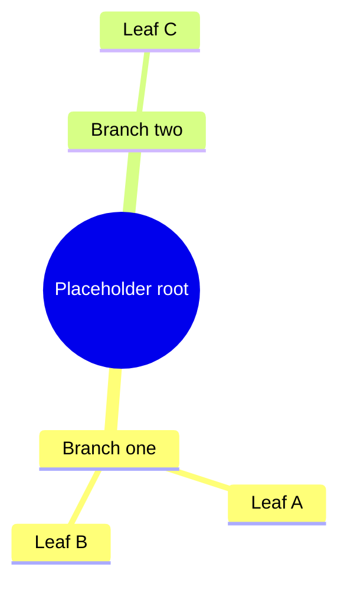

#   Welcome to the demo

This   paragraph has **placeholder** text and shows normal Markdown formatting.

<!--
  Source is messy: unsorted Vue attrs / UnoCSS classes and uneven indent.
  After format: attrs and classes are sorted; the inner 
 is Vue-formatted.
-->

<v-click>

<h2 class="text-xl font-bold mb-2" id="greeting">Hello, {{ name }}!</h2>

Here is some placeholder content inside a Vue component.

<button
@click="showMessage = false"
class="text-white px-4 py-2 bg-blue-700 rounded"
type="button"
>
Dismiss
</button>

</v-click>

---

#   A second slide

<!--
  Source is messy: nested Vue indentation and attribute order are inconsistent.
  After format: indentation is normalized; attrs and UnoCSS classes are sorted.
  There is no blank-line Markdown zone here — the whole tree is formatted as Vue.
-->

<article
class="text-white p-6 bg-purple-600 rounded-xl shadow-lg"
id="feature-card"
v-if="showCard"
>
<h2 class="text-2xl font-bold mb-3">A sample feature card</h2>

This nested content has intentionally inconsistent indentation.

<ul class="pl-6 list-disc text-white">
<li class="mb-2">Placeholder list item one</li>
<li class="mb-2">Placeholder list item two</li>
</ul>
<button
type="button"
@click="showCard = false"
class="text-white px-4 py-2 bg-purple-800 rounded"
>
Hide card
</button>
</article>

---

# Markdown islands inside components

<!--
  Without island protection, Vue formatting would collapse the blank-line
  Markdown heading and list into wrapped HTML text.
  After format: heading + list stay Markdown; nested 
 stay Vue.
  Blank lines after tags are required (Slidev ends the HTML block there).
  Nested tags use 2-space indent so CommonMark does not treat them as code.
-->

  

    Placeholder lead-in about building satellite sites from a shared template.
  

## Sample region heading

  

    Choose a locality and a topic, register a domain, and the placeholder
    satellite is ready.
  

  
Placeholder examples of generated sites:

  <v-clicks>

- Alpha repair services for Sample City, Example State.
- Beta appliances for Sample Harbor, Example Country.
- Gamma parts and services for Sample Metro, Example Region.

  </v-clicks>

  
And the same pattern for any other placeholder topic.

---

# Fenced diagram inside v-click

<!--
  Without island protection, Vue formatting would reflow the fence, destroy
  Mermaid indentation, and wrap lines at printWidth.
  After format: the fence structure is preserved, with blank lines around it
  so Slidev (and reformat) keep a Markdown zone.
-->

<v-click at="1">

</v-click>
